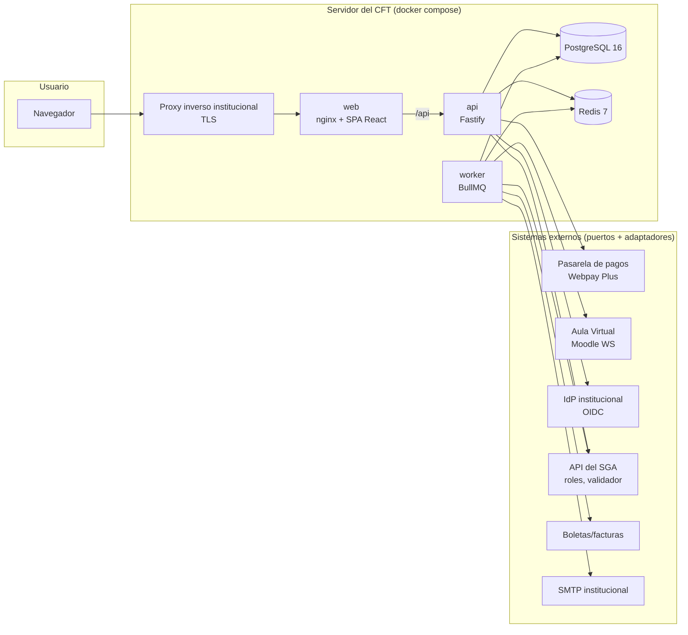
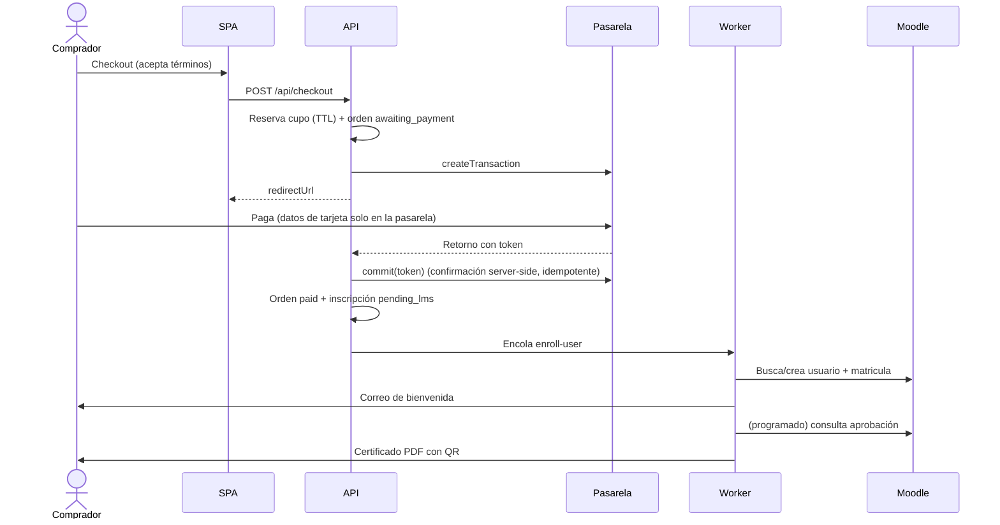
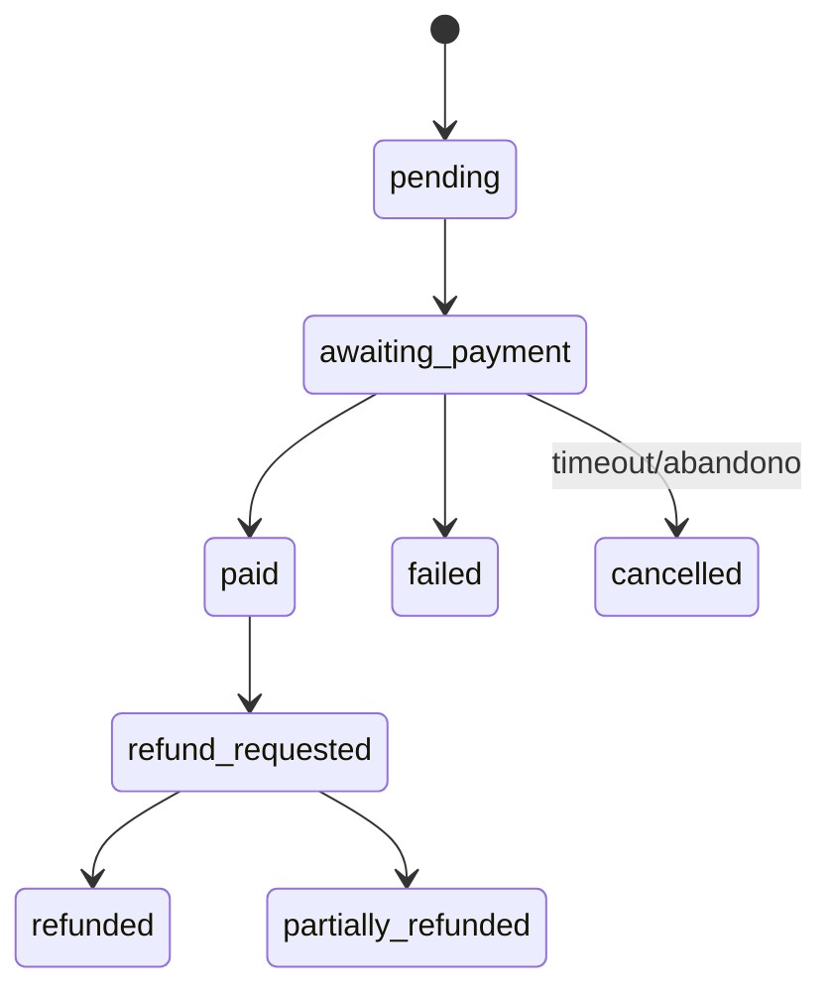
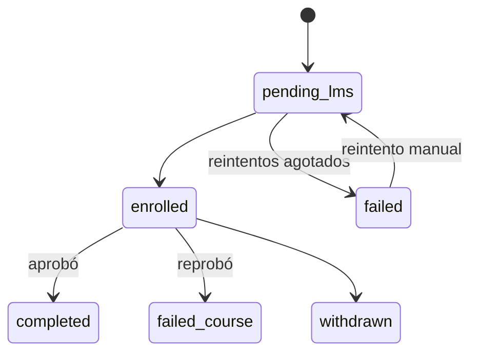
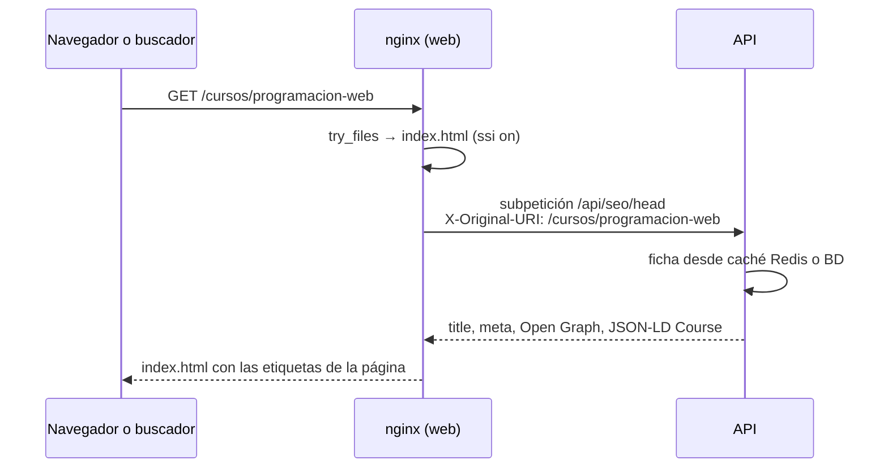
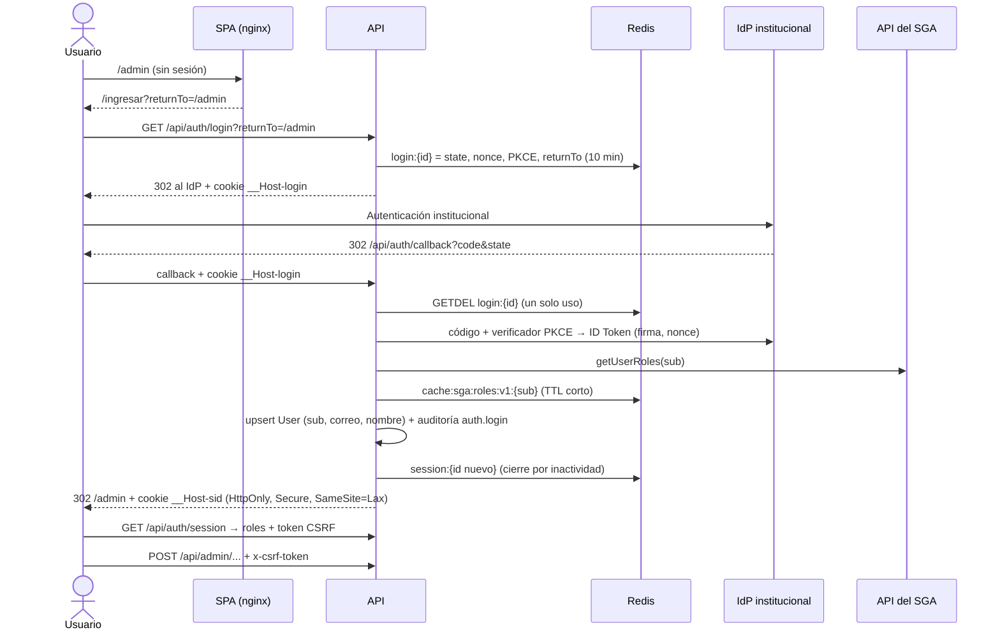
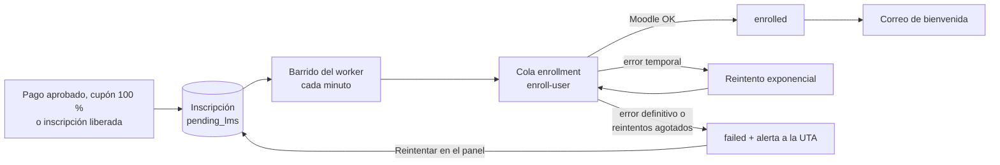
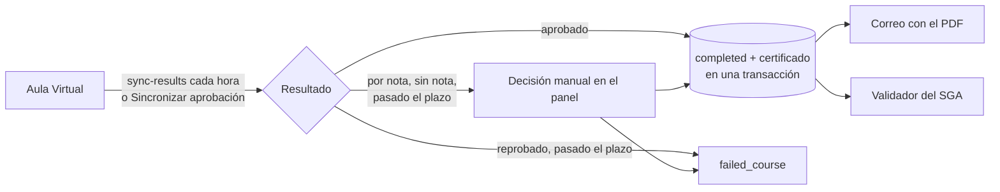
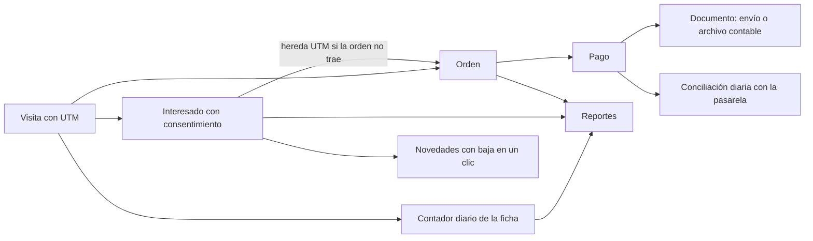

# Arquitectura

## Componentes



- **web**: nginx sin privilegios que sirve la SPA (assets con hash y caché inmutable) y
  reenvía `/api` a la API. Define la CSP del sitio.
- **api**: Fastify con validación Zod en entrada y salida, OpenAPI en `/api/docs`, cabeceras de
  seguridad (helmet), CORS restringido, rate limit compartido en Redis, auditoría y manejo de
  errores en español.
- **worker**: el mismo código de la API en otro proceso (`dist/worker.js`); procesa las colas
  BullMQ con reintentos exponenciales (matrícula, certificados, correos, conciliación).
- **migrate**: contenedor de un solo uso que aplica las migraciones de Prisma antes de arrancar
  la API y el worker.

## Puertos y adaptadores

Cada sistema externo se usa a través de una interfaz (puerto) en
`apps/api/src/integrations/<sistema>/port.ts`, con un adaptador simulado y uno real. El
adaptador se elige con una variable `*_DRIVER` validada al arranque. Los módulos de dominio
solo conocen el puerto: cambiar de pasarela o confirmar el contrato del SGA no toca la lógica
de negocio. Detalle en [integraciones.md](integraciones.md).

## Flujo principal (objetivo; las fases 3 y 4 ya lo cubren hasta la orden pagada)



## Máquinas de estado (órdenes y pagos en `modules/payments/state-machine.ts`)





## Decisiones de la Fase 0

| Decisión                                       | Motivo                                                                                                                                        |
| ---------------------------------------------- | --------------------------------------------------------------------------------------------------------------------------------------------- |
| Prisma 6 como ORM                              | Lo nombra la especificación; migraciones maduras. Prisma 7+ cambió a cliente ESM con adaptadores: se evaluará al estabilizarse.               |
| Zod 4 + `fastify-type-provider-zod` 6          | Un solo esquema genera validación, tipos y OpenAPI. Los esquemas que comparte la SPA viven en `packages/shared`.                              |
| Configuración validada al arranque             | La API no arranca si falta una variable; en `production` se bloquean los adaptadores simulados.                                               |
| Rate limit con `skipOnError`                   | Si Redis cae, la API sigue atendiendo sin límite y `/api/ready` lo reporta (disponibilidad antes que rechazar todo).                          |
| Pruebas de integración contra servicios reales | PostgreSQL y Redis de compose en local y servicios de GitHub Actions en CI, sin Testcontainers: menos dependencias y el mismo comportamiento. |
| Logs sin datos personales                      | pino redacta tokens, credenciales y datos personales, y quita la query string de las URLs.                                                    |

## SEO de la SPA (Fase 1, RF-02)

Los buscadores y las redes sociales leen el HTML antes de ejecutar JavaScript. nginx inserta
en el `<head>` del `index.html` las etiquetas de cada página usando **SSI** (Server Side
Includes, incluido en nginx): no hay prerender ni un servidor Node extra para el HTML.



- Si la API falla o responde con error, nginx usa el bloque `seo_default` del propio
  `index.html` (título y descripción genéricos): el sitio nunca queda sin responder.
- Solo las rutas públicas conocidas (`/`, `/cursos`, `/cursos/:slug`) son indexables; el resto
  y los cursos inexistentes llevan `noindex`. Fuera de producción todo es `noindex` y
  `robots.txt` bloquea el sitio (`SEO_ALLOW_INDEXING`).
- `/sitemap.xml` y `/robots.txt` los genera la API y nginx los publica en la raíz.

## Decisiones de la Fase 1

| Decisión                                                          | Motivo                                                                                                                                                                                   |
| ----------------------------------------------------------------- | ---------------------------------------------------------------------------------------------------------------------------------------------------------------------------------------- |
| Búsqueda con `tsvector` mantenido por trigger                     | Prisma no expresa columnas generadas; el trigger evita diferencias en `migrate diff`. Configuración `spanish` + `unaccent` en documento y consulta; términos por prefijo unidos con `&`. |
| Términos de búsqueda saneados en el servidor                      | Solo letras y números llegan a `to_tsquery`, como parámetro: sin inyección ni errores de sintaxis por lo que escriba el usuario.                                                         |
| Caché en dos niveles: ficha (60 s) y cupos (15 s)                 | La ficha cambia poco; los cupos deben verse casi en tiempo real. Redis es opcional: si falla, se lee de la BD.                                                                           |
| Cupos = capacidad − inscripciones no retiradas − reservas activas | Las inscripciones `failed` (falló el Aula Virtual) siguen ocupando cupo: el pago ya existe.                                                                                              |
| SEO con nginx SSI                                                 | Una sola fuente del HTML (la SPA), sin prerender ni Node para servir páginas; degradación segura si la API falla.                                                                        |
| Triggers de "sin borrado" en la BD                                | La regla no depende del código: también protege ante errores o consultas manuales. Incluye `TRUNCATE`.                                                                                   |
| Datos de demostración solo en desarrollo y CI                     | El contenedor `migrate` los carga con `compose.yaml`; staging y producción no cargan datos de prueba.                                                                                    |

## Identidad, sesiones y roles (Fase 2, RF-10)



Una petición a una ruta protegida pasa por estos pasos, en orden:

1. **Sesión**: se lee `session:{id}` de Redis y se renueva el cierre por inactividad. Si la
   sesión pasó su duración máxima, se borra.
2. **Acceso** (`config.access` de la ruta): sin sesión, 401.
3. **CSRF**: en una mutación, el `Origin` debe ser el de la SPA y la cabecera `x-csrf-token`
   debe coincidir con el token de la sesión.
4. **Roles**: se leen de la caché o del SGA.
5. **Permiso**: si el rol no lo tiene, 403.

## Panel de administración y auditoría (Fase 2, RF-07 y RF-12)

- Cada cambio del panel se guarda en una transacción junto con su entrada en `audit_logs`:
  si la auditoría falla, el cambio no se aplica.
- Después del cambio se invalida la caché pública del catálogo: las fichas afectadas (al
  cambiar el slug, la anterior y la nueva), todas las páginas del listado (borrado por
  prefijo con `SCAN`), los destacados, las áreas y el sitemap. El sitio muestra el cambio en
  la siguiente petición. El navegador puede conservar una ficha ya vista hasta 15 s
  (`Cache-Control: max-age=15`, Fase 1).
- Los cursos se archivan, no se borran. Las ediciones solo se eliminan si son borradores
  sin inscripciones, órdenes, reservas, lista de espera ni cupones; si no, se despublican.

## Decisiones de la Fase 2

| Decisión                                                        | Motivo                                                                                                                                                              |
| --------------------------------------------------------------- | ------------------------------------------------------------------------------------------------------------------------------------------------------------------- |
| Sesión de servidor en Redis, no JWT en el navegador             | Se puede revocar al instante (cerrar sesión, bloquear usuario), la cookie no lleva datos personales y el tamaño no crece con los roles.                             |
| Cookie `__Host-` + `SameSite=Lax` + token CSRF sincronizado     | `__Host-` impide que un subdominio la reemplace; `Lax` permite volver del IdP; el token y la revisión de `Origin` protegen las mutaciones (defensa en profundidad). |
| Roles consultados al SGA con caché corta, no guardados en la BD | El SGA es la fuente de verdad (la ficha prohíbe bases paralelas); un cambio rige a lo más en `SGA_ROLES_CACHE_TTL_SECONDS`. Si el SGA cae, se niega el acceso.      |
| `config.access` obligatorio en cada ruta `/api`                 | Una ruta nueva sin declarar su acceso impide que la API arranque: no hay endpoints abiertos por olvido. Una prueba recorre todas las rutas del panel con cada rol.  |
| Permisos en `packages/shared`                                   | La misma tabla decide en la API (autoriza) y en la SPA (qué menú muestra). La SPA nunca es la barrera: la API valida cada llamada.                                  |
| Auditoría en la misma transacción y con diff                    | No hay cambios sin rastro; el antes y después solo incluye los campos modificados, para que se lea fácil.                                                           |
| Formularios del panel con los esquemas de la API                | Las mismas reglas (fechas, nota mínima, perfiles) validan en el navegador y en el servidor.                                                                         |
| Texto plano en las descripciones (sin editor enriquecido)       | El editor con limpieza de HTML (RF-07) se agrega cuando se definan los textos legales; hoy evita superficie XSS.                                                    |

## Carrito y checkout (Fase 3, RF-03, RF-04 y RF-11)

```mermaid
sequenceDiagram
  actor C as Comprador
  participant W as SPA
  participant A as API
  participant D as PostgreSQL
  C->>W: Agrega ediciones (sin sesión: ids en el navegador)
  C->>W: Ingresa (SSO)
  W->>A: POST /api/cart/merge (fusiona el carrito del navegador)
  W->>A: POST /api/checkout/quote (cupón, textos legales vigentes)
  C->>W: Acepta los 4 textos (casillas sin marcar) y confirma
  W->>A: POST /api/checkout/orders + Idempotency-Key
  A->>D: BEGIN; SELECT … FROM course_editions … FOR UPDATE
  A->>D: cupos = capacidad − inscripciones − reservas vigentes
  A->>D: orden (precios congelados, aceptación legal, número UTA-AAAA-NNNNNN)
  A->>D: reservas (TTL) · uso del cupón · documento tributario · auditoría
  A->>D: COMMIT
  A-->>W: 201 orden awaiting_payment (o paid si el total es $0)
  Note over A: El worker anula cada minuto las órdenes cuyo plazo venció
```

El pago con la pasarela empieza desde la orden `awaiting_payment` (Fase 4).

## Decisiones de la Fase 3

| Decisión                                                                  | Motivo                                                                                                                                                                         |
| ------------------------------------------------------------------------- | ------------------------------------------------------------------------------------------------------------------------------------------------------------------------------ |
| Reserva al confirmar la compra, no al abrir el checkout                   | El cupo se retiene en el momento que importa (mientras se paga en la pasarela), y visitar el checkout no bloquea cupos de otras personas.                                      |
| `SELECT … FOR UPDATE` sobre las ediciones, en orden de id                 | Dos compras del último cupo se serializan sin aislamiento `SERIALIZABLE` (sin reintentos por conflicto); el orden fijo evita bloqueos mutuos con carritos de varias ediciones. |
| Las reservas vencidas no cuentan aunque el job no haya pasado             | La disponibilidad no depende del worker: el job solo deja consistente el estado de la orden, el cupón y la reserva.                                                            |
| Idempotencia con columna única `orders.idempotency_key`                   | Un doble clic o un reintento tras un corte devuelve la misma orden; dos confirmaciones simultáneas con la misma clave chocan en la BD y la segunda devuelve la primera.        |
| Precios y descuentos congelados en `order_items`                          | El total de una orden no cambia si después se edita el precio de la edición o el cupón.                                                                                        |
| Monto fijo una vez por orden; porcentaje por ítem, redondeado hacia abajo | Pesos enteros (regla 8); el descuento nunca supera lo declarado ni deja un ítem bajo $0.                                                                                       |
| Textos legales inmutables (trigger) y hash de la aceptación               | La orden prueba qué versión exacta aceptó el comprador; cambiar un texto exige publicar una versión nueva.                                                                     |
| Markdown sin HTML para los textos                                         | Formato suficiente para textos legales sin superficie XSS (sanitización exigida por RF-07).                                                                                    |
| Carrito anónimo solo con ids en `localStorage`                            | Sin datos personales en el navegador ni cuentas para mirar precios; se fusiona al ingresar.                                                                                    |

## Pagos (Fase 4, RF-03)

```mermaid
sequenceDiagram
  actor C as Comprador
  participant W as SPA
  participant A as API
  participant G as Pasarela
  participant Q as Worker
  C->>W: Pagar en /ordenes/:numero
  W->>A: POST /api/orders/:numero/pay
  A->>G: createTransaction (buyOrder UTA-AAAA-NNNNNN-intento)
  A-->>W: URL y token
  C->>G: Paga (la tarjeta nunca pasa por la plataforma)
  G-->>A: Retorno con token_ws
  A->>A: created → confirming (condicional; orden vigente)
  A->>G: commit(token)
  A->>A: Verifica monto y orden; pago authorized, orden paid, inscripciones pending_lms
  A-->>C: 303 /ordenes/:numero?pago=aprobado
  Q->>C: Correo con el comprobante PDF
```

| Situación                                                 | Qué hace la plataforma                                                                                                                   |
| --------------------------------------------------------- | ---------------------------------------------------------------------------------------------------------------------------------------- |
| Doble retorno del navegador                               | Solo el primero pasa a `confirming` y llama a `commit`; el otro muestra el resultado ya guardado.                                        |
| Rechazado o abandonado                                    | La orden sigue `awaiting_payment` mientras dure la reserva, hasta 3 intentos fallidos; después pasa a `failed` y libera cupos y cupón.   |
| Retorno con la orden vencida                              | No se llama a `commit`: en Webpay eso significa que no hay cobro.                                                                        |
| Vencimiento durante la confirmación                       | El worker no anula órdenes con un pago `confirming`, y la reserva se extiende 5 minutos al iniciar la confirmación.                      |
| Monto u orden distintos, u orden que ya no se puede pagar | Reversa inmediata por la pasarela, pago `failed`, auditoría y alerta a `UTA_ALERT_EMAIL`.                                                |
| Corte de red durante `commit`                             | Se consulta `getStatus`; si tampoco responde, el pago queda `confirming` y el worker lo retoma. La página de la orden se actualiza sola. |
| Falla del correo                                          | El pago sigue válido: `orders.receipt_sent_at` queda vacío y el worker reintenta en la siguiente pasada.                                 |

## Decisiones de la Fase 4

| Decisión                                                               | Motivo                                                                                                                                           |
| ---------------------------------------------------------------------- | ------------------------------------------------------------------------------------------------------------------------------------------------ |
| Estado `confirming` tomado con una actualización condicional           | Una sola operación decide quién confirma: resuelve el doble retorno y el cruce con el vencimiento sin bloquear filas durante una llamada de red. |
| Correo por barrido del worker, no por evento                           | La API no depende de la cola para confirmar un pago, y un correo nunca se pierde si Redis o SMTP fallan en ese momento.                          |
| `failed` no cuenta como intento del comprador                          | Un error de la pasarela o un intento reemplazado no es culpa de quien paga; solo cuentan `rejected` y `aborted`.                                 |
| Devolución entre dos transacciones, con la orden en `refund_requested` | No se retiene un bloqueo durante la llamada a la pasarela, y el estado impide una segunda devolución simultánea.                                 |
| Solo la devolución total retira la inscripción                         | Una devolución parcial es un ajuste de precio; quitar el acceso es una decisión aparte.                                                          |

## Matrícula y lista de espera (Fase 5, RF-04 y RF-05)



Cuando hay un cupo libre en una edición con fila, el worker crea una reserva sin orden para el
siguiente y le avisa por correo. Esa reserva cuenta como cupo ocupado para las demás personas,
y solo quien tiene la oferta puede usarla. Si vence, pasa al siguiente.

## Decisiones de la Fase 5

| Decisión                                                                    | Motivo                                                                                                   |
| --------------------------------------------------------------------------- | -------------------------------------------------------------------------------------------------------- |
| Inscripciones encoladas por barrido, no al confirmar el pago                | Confirmar un pago no depende de Redis y ninguna matrícula se pierde. Demora máxima: cerca de un minuto.  |
| Un trabajo por inscripción con `jobId` fijo                                 | Evita matricular dos veces; el barrido retira el trabajo terminado para permitir el reintento manual.    |
| Bienvenida, desmatrícula y ofertas como barridos aparte, con marca de fecha | Si el correo o Moodle fallan, se reintenta solo esa parte sin repetir lo demás.                          |
| Lista de espera por barrido de cupos libres                                 | Cubre todas las causas (devolución, retiro, aumento de cupos, orden vencida) sin engancharse a cada una. |
| Cupo retenido con una reserva sin orden                                     | Reutiliza el conteo de cupos existente: nadie más puede tomarlo mientras dura la oferta.                 |
| Reactivar la inscripción retirada al volver a comprar                       | El índice único usuario + edición impide una segunda fila.                                               |

## Certificados (Fase 6, RF-06)



Moodle informa quién aprobó, no quién reprobó: reprobar se decide por tiempo, pasados
`COURSE_RESULT_GRACE_DAYS` desde el término de la edición.

## Decisiones de la Fase 6

| Decisión                                                  | Motivo                                                                                         |
| --------------------------------------------------------- | ---------------------------------------------------------------------------------------------- |
| El PDF no se guarda: se regenera y se conserva su SHA-256 | Es determinista, evita almacenar archivos con datos personales y permite comprobar integridad. |
| El PDF y la verificación no muestran nota ni RUT          | Datos personales mínimos (Ley 21.719).                                                         |
| Correo y validador como barridos aparte, con marca        | Si fallan, se reintenta solo esa parte; el certificado ya es válido en `/verificar`.           |
| Reemisión con código nuevo                                | El certificado anterior sigue verificable como reemplazado e indica el código vigente.         |
| Código de 60 bits aleatorios, alfabeto de Crockford       | No es secuencial ni enumerable, y tolera errores de transcripción (O por 0, I y L por 1).      |
| Diseño único y provisional, sin logo real                 | Falta la identidad gráfica oficial; `certificateTemplate` aún no se usa.                       |

## Ventas, reportes y difusión (Fase 7, RF-02, RF-08, RF-09)



## Decisiones de la Fase 7

| Decisión                                                            | Motivo                                                                                             |
| ------------------------------------------------------------------- | -------------------------------------------------------------------------------------------------- |
| La conciliación solo marca diferencias                              | Cambiar un pago por su cuenta podría ocultar un error; lo resuelve una persona y queda auditado.   |
| Visitas como contador por día, curso y campaña                      | Basta para la conversión y no recolecta datos personales (Ley 21.719).                             |
| UTM en `sessionStorage`                                             | Acompañan la visita, también tras la pasarela, sin dejar rastro entre sesiones.                    |
| Baja por correo, no por registro                                    | Quien se da de baja no debe seguir recibiendo novedades por haber consultado otro curso.           |
| Reportes calculados al consultar                                    | El volumen esperado es bajo; evita tablas resumen que se desincronicen.                            |
| Una venta cuenta en el período en que se pagó, con sus devoluciones | Cada venta se ve con su resultado final. Un mes cerrado puede cambiar si hay devoluciones después. |
| Devolución repartida entre cursos por su peso en la orden           | Una devolución es por orden; el reporte por curso necesita asignarla sin perder pesos.             |
| XLSX escrito sobre `fflate`, sin `exceljs`                          | `exceljs` arrastra `buffers`, sin licencia declarada, y la tabla es simple.                        |
| Textos de CSV protegidos contra fórmulas                            | Un nombre escrito por un comprador no debe ejecutarse al abrir el archivo.                         |

## Decisiones de la Fase 8

| Decisión                                           | Motivo                                                                               |
| -------------------------------------------------- | ------------------------------------------------------------------------------------ |
| Rate limit por usuario con sesión, por IP sin ella | En la red del CFT muchas personas comparten IP y no deben agotar el límite entre sí. |
| Anonimizar en vez de borrar al titular             | Las órdenes y pagos no se pueden borrar: se quita lo que identifica a la persona.    |
| El certificado conserva el nombre al anonimizar    | Debe seguir verificable; la persona puede pedir la revocación.                       |
| Solicitudes de titulares por POST                  | El correo no debe quedar en URL, que terminan en registros intermedios.              |
| `restore.sh` solo escribe en una base nueva        | Evita pisar datos en plena emergencia; la base anterior se conserva hasta validar.   |
| Prueba de carga manual o al cambiar, no en cada PR | Tarda varios minutos y su resultado depende de la máquina del CI.                    |

## Decisiones de la Fase 9

| Decisión                                  | Motivo                                                                                    |
| ----------------------------------------- | ----------------------------------------------------------------------------------------- |
| Descripción en Markdown sin HTML          | Da formato sin un editor pesado y reutiliza la sanitización de los textos legales.        |
| Vista previa con los datos del formulario | Muestra lo que se está escribiendo, sin guardar ni exponer borradores por la API pública. |
| El color se valida contra el texto blanco | Quien configura no puede romper el contraste AA del encabezado y los botones.             |
| Sin subida de logo                        | Requiere almacenamiento de archivos y la identidad oficial aún no existe (Q8).            |
