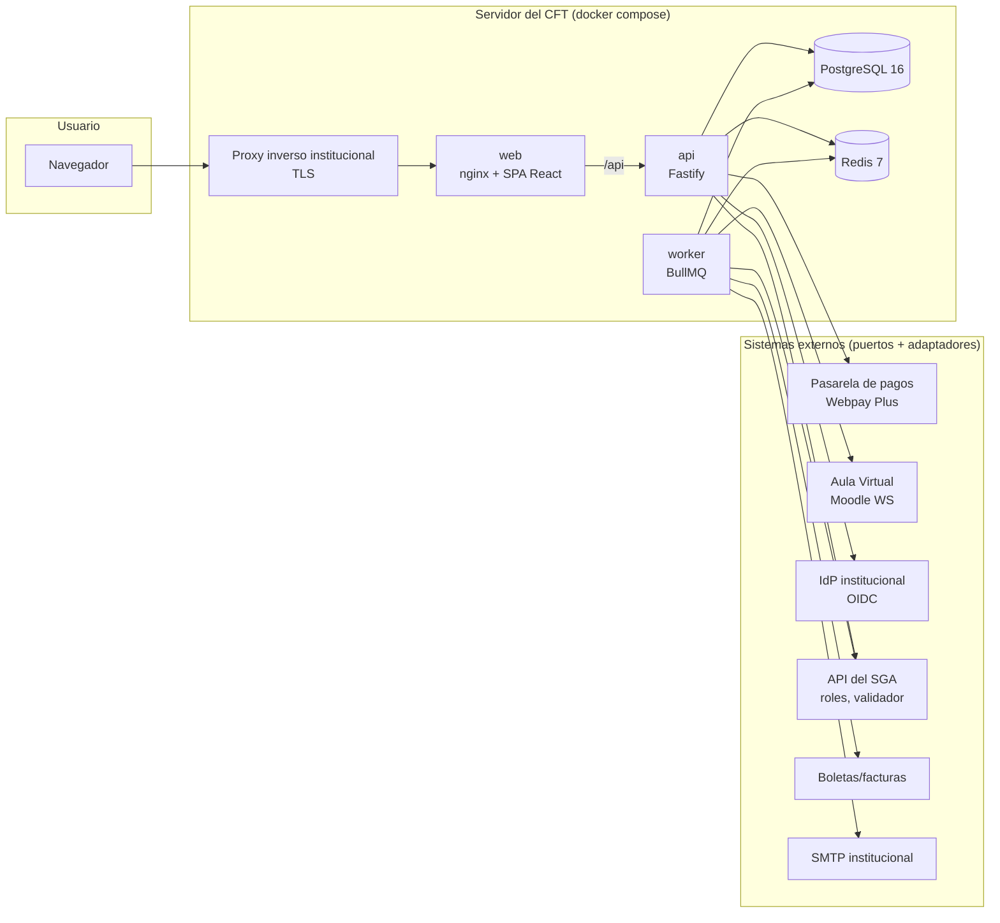
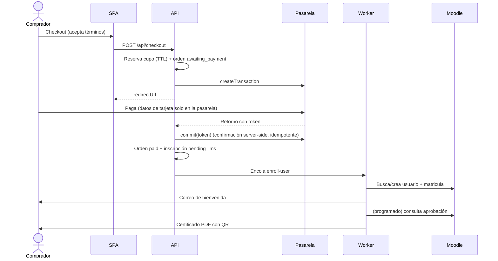
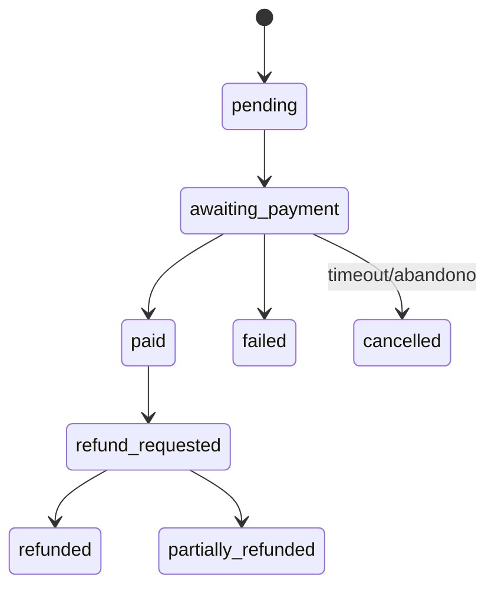
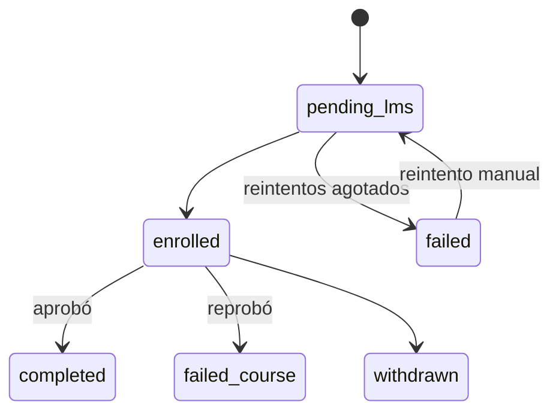
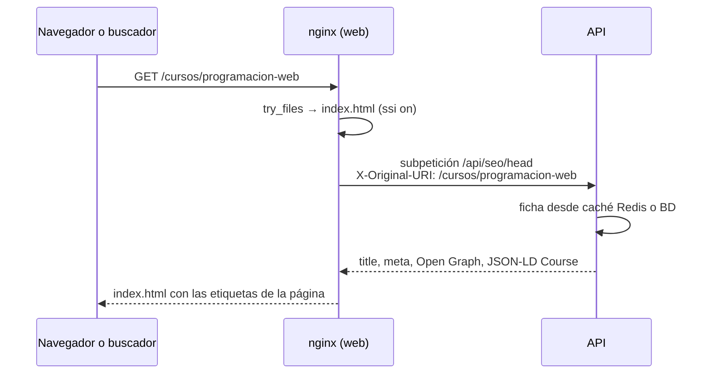

# Arquitectura

## Componentes

- **web**: nginx sin privilegios que sirve la SPA (assets con hash y caché inmutable) y
  reenvía `/api` a la API. Define la CSP del sitio.
- **api**: Fastify con validación Zod en entrada y salida, OpenAPI en `/api/docs`, cabeceras de
  seguridad (helmet), CORS restringido, rate limit compartido en Redis, auditoría y manejo de
  errores en español.
- **worker**: el mismo código de la API en otro proceso (`dist/worker.js`); procesa las colas
  BullMQ con reintentos exponenciales (matrícula, certificados, correos, conciliación).
- **migrate**: contenedor de un solo uso que aplica las migraciones de Prisma antes de arrancar
  la API y el worker.

## Puertos y adaptadores

Cada sistema externo se usa a través de una interfaz (puerto) en
`apps/api/src/integrations/<sistema>/port.ts`, con un adaptador simulado y uno real. El
adaptador se elige con una variable `*_DRIVER` validada al arranque. Los módulos de dominio
solo conocen el puerto: cambiar de pasarela o confirmar el contrato del SGA no toca la lógica
de negocio. Detalle en [integraciones.md](integraciones.md).

## Flujo principal (objetivo, se construye en las fases 3 a 6)

## Máquinas de estado (definidas en la especificación, se implementan en las fases 3 a 6)

## Decisiones de la Fase 0

| Decisión                                       | Motivo                                                                                                                                        |
| ---------------------------------------------- | --------------------------------------------------------------------------------------------------------------------------------------------- |
| Prisma 6 como ORM                              | Lo nombra la especificación; migraciones maduras. Prisma 7+ cambió a cliente ESM con adaptadores: se evaluará al estabilizarse.               |
| Zod 4 + `fastify-type-provider-zod` 6          | Un solo esquema genera validación, tipos y OpenAPI. Los esquemas que comparte la SPA viven en `packages/shared`.                              |
| Configuración validada al arranque             | La API no arranca si falta una variable; en `production` se bloquean los adaptadores simulados.                                               |
| Rate limit con `skipOnError`                   | Si Redis cae, la API sigue atendiendo sin límite y `/api/ready` lo reporta (disponibilidad antes que rechazar todo).                          |
| Pruebas de integración contra servicios reales | PostgreSQL y Redis de compose en local y servicios de GitHub Actions en CI, sin Testcontainers: menos dependencias y el mismo comportamiento. |
| Logs sin datos personales                      | pino redacta tokens, credenciales y datos personales, y quita la query string de las URLs.                                                    |

## SEO de la SPA (Fase 1, RF-02)

Los buscadores y las redes sociales leen el HTML antes de ejecutar JavaScript. nginx inserta
en el `<head>` del `index.html` las etiquetas de cada página usando **SSI** (Server Side
Includes, incluido en nginx): no hay prerender ni un servidor Node extra para el HTML.

- Si la API falla o responde con error, nginx usa el bloque `seo_default` del propio
  `index.html` (título y descripción genéricos): el sitio nunca queda sin responder.
- Solo las rutas públicas conocidas (`/`, `/cursos`, `/cursos/:slug`) son indexables; el resto
  y los cursos inexistentes llevan `noindex`. Fuera de producción todo es `noindex` y
  `robots.txt` bloquea el sitio (`SEO_ALLOW_INDEXING`).
- `/sitemap.xml` y `/robots.txt` los genera la API y nginx los publica en la raíz.

## Decisiones de la Fase 1

| Decisión                                                          | Motivo                                                                                                                                                                                   |
| ----------------------------------------------------------------- | ---------------------------------------------------------------------------------------------------------------------------------------------------------------------------------------- |
| Búsqueda con `tsvector` mantenido por trigger                     | Prisma no expresa columnas generadas; el trigger evita diferencias en `migrate diff`. Configuración `spanish` + `unaccent` en documento y consulta; términos por prefijo unidos con `&`. |
| Términos de búsqueda saneados en el servidor                      | Solo letras y números llegan a `to_tsquery`, como parámetro: sin inyección ni errores de sintaxis por lo que escriba el usuario.                                                         |
| Caché en dos niveles: ficha (60 s) y cupos (15 s)                 | La ficha cambia poco; los cupos deben verse casi en tiempo real. Redis es opcional: si falla, se lee de la BD.                                                                           |
| Cupos = capacidad − inscripciones no retiradas − reservas activas | Las inscripciones `failed` (falló el Aula Virtual) siguen ocupando cupo: el pago ya existe.                                                                                              |
| SEO con nginx SSI                                                 | Una sola fuente del HTML (la SPA), sin prerender ni Node para servir páginas; degradación segura si la API falla.                                                                        |
| Triggers de "sin borrado" en la BD                                | La regla no depende del código: también protege ante errores o consultas manuales. Incluye `TRUNCATE`.                                                                                   |
| Datos de demostración solo en desarrollo y CI                     | El contenedor `migrate` los carga con `compose.yaml`; staging y producción no cargan datos de prueba.                                                                                    |
