# Manual de administración

Guía para el equipo de la UTA. Se entra con la cuenta institucional, en **Panel**.

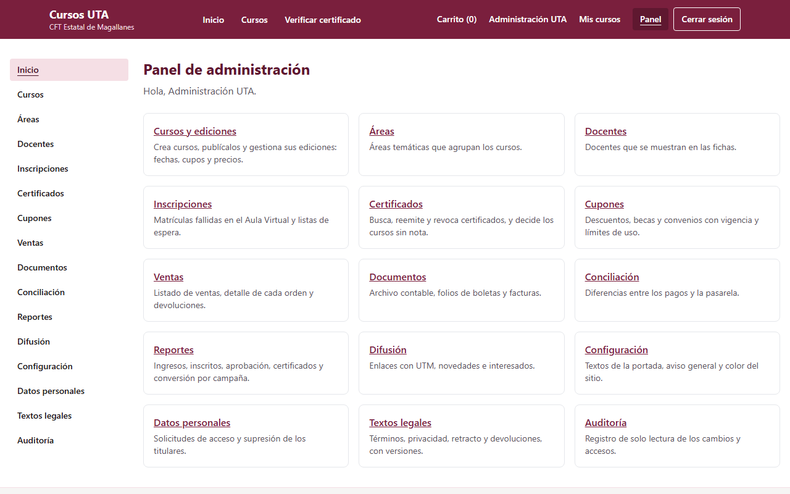

## Qué puede hacer cada rol

Los roles vienen del SGA.

| Sección                           | Administración | Edición | Finanzas | Reportes |
| --------------------------------- | :------------: | :-----: | :------: | :------: |
| Cursos, áreas y docentes          |       ✔        |    ✔    | Solo ver |          |
| Inscripciones y certificados      |       ✔        |    ✔    |          |          |
| Difusión                          |       ✔        |    ✔    |          |          |
| Cupones                           |       ✔        |         |    ✔     |          |
| Ventas, documentos y conciliación |       ✔        |         |    ✔     |          |
| Reportes                          |       ✔        |         |    ✔     |    ✔     |
| Configuración y textos legales    |       ✔        |         |          |          |
| Datos personales y auditoría      |       ✔        |         |          |          |

## Publicar un curso

1. Crea primero el **Área** y los **Docentes**, si no existen.
2. En **Cursos**, crea el curso y completa su ficha.
3. Revisa **Vista previa de la ficha**, abajo en el formulario.
4. Guarda y pulsa **Publicar**.

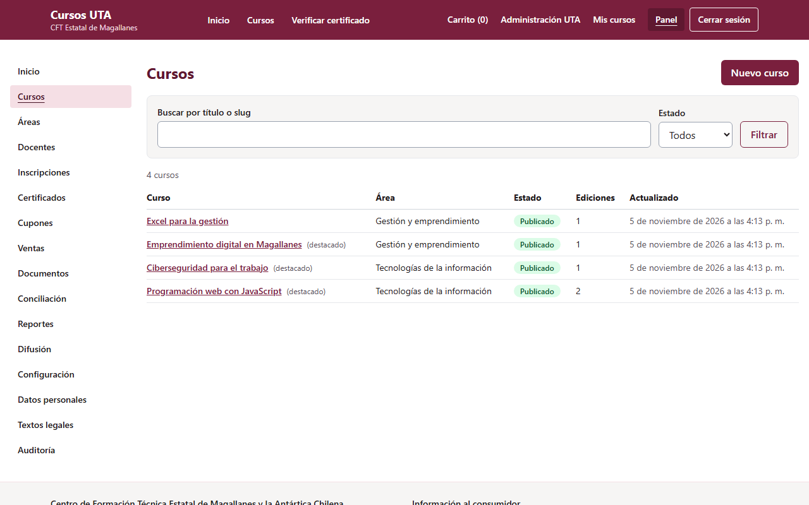

La descripción admite formato: `##` para títulos, `-` para listas y `**negrita**`. No admite HTML.

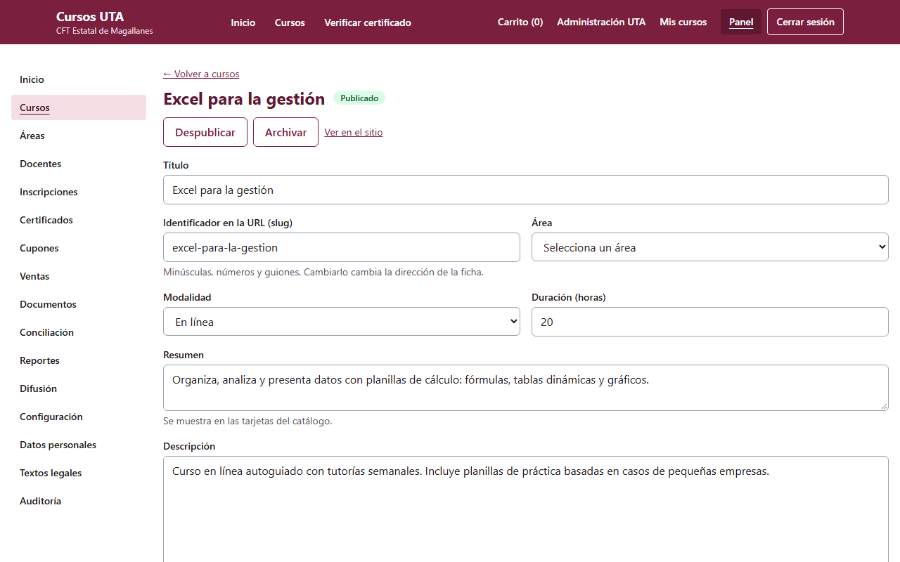

### Ediciones

Una edición es una versión del curso con fechas, cupos y precio. Dentro del curso puedes crearla,
**Publicar** y **Duplicar** para repetirla.

- **Curso en el Aula Virtual (id Moodle):** sin este dato no se puede matricular.
- **Criterio de aprobación:** por finalización o por nota.
- **Sin pago para la comunidad CFT:** indica qué perfiles se inscriben sin pagar.
- **Tratamiento tributario:** afecto o exento.

Un curso publicado aparece en el sitio. Sus ediciones se muestran si están publicadas y aún no
terminan.

## Cupones

En **Cupones** se crean descuentos por porcentaje o monto, con vigencia, usos máximos y alcance. Un
cupón del 100 % inscribe sin pasar por la pasarela.

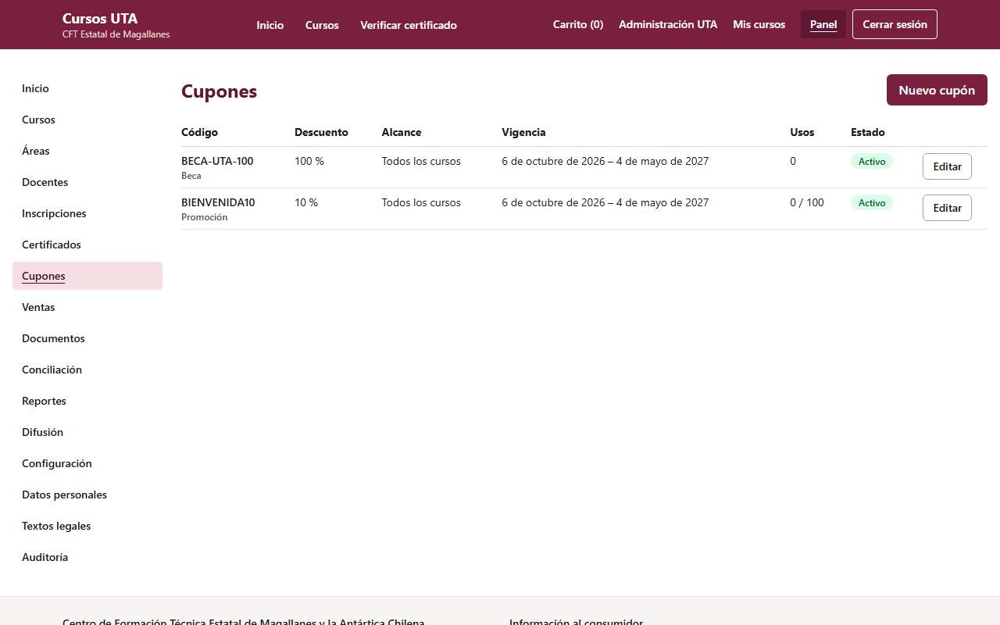

## Inscripciones

La matrícula en el Aula Virtual es automática. En **Inscripciones** ves:

- **Matrículas fallidas:** pulsa **Reintentar** cuando el problema esté resuelto.
- **Matrículas en proceso** y **Listas de espera**.

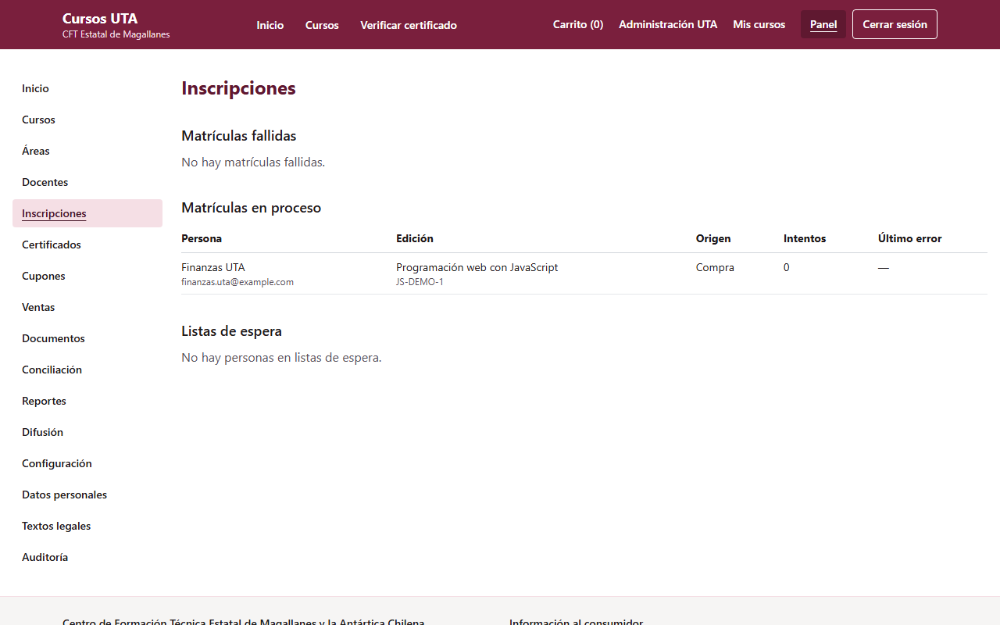

## Certificados

El sistema revisa cada hora quién aprobó en el Aula Virtual, emite el certificado y lo envía por
correo. En una edición también puedes pulsar **Sincronizar aprobación** para hacerlo de inmediato.

En **Certificados** puedes:

- **Buscar** por código, correo o nombre.
- **Reemitir** para corregir un nombre. Se crea un código nuevo y el anterior indica cuál lo reemplaza.
- **Revocar**, con un motivo. La página de verificación lo mostrará como revocado.
- Decidir los **cursos sin nota**: si un curso por nota no tiene nota 30 días después de terminar,
  debes indicar si aprobó.

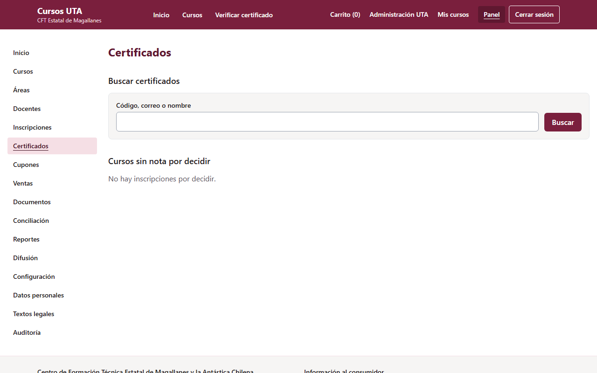

## Ventas y devoluciones

**Ventas** lista las órdenes, con filtros y descarga en Excel o CSV. Al abrir una orden ves sus pagos,
su historial y sus devoluciones.

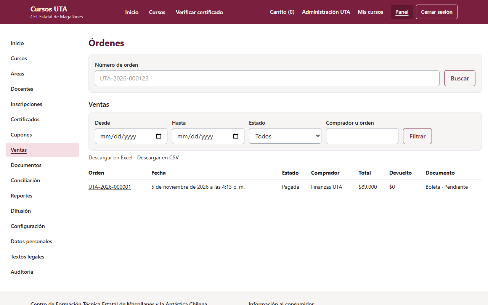

Para devolver, escribe el monto y el motivo. La devolución va por la pasarela y **no se puede
deshacer**. Una devolución total retira la inscripción, desmatricula del Aula Virtual y libera el
cupo. Una parcial no cambia la inscripción.

## Documentos

En **Documentos** están las boletas y facturas de las órdenes pagadas.

- Con el sistema de emisión conectado, el folio llega solo.
- Sin conexión, descarga el **archivo contable**, emite los documentos y registra cada **Folio**.
- Un documento con error se puede **Reintentar**.

Una devolución no anula el documento: la nota de crédito se hace en el sistema de emisión.

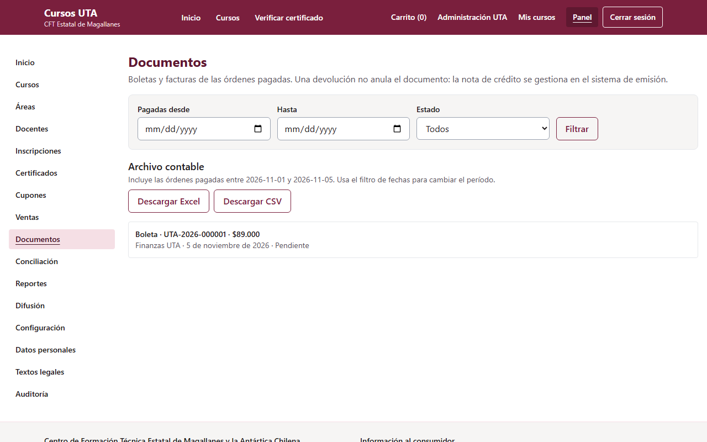

## Conciliación

Cada mañana el sistema compara los pagos del día anterior con la pasarela. En **Conciliación** aparecen
las diferencias. También puedes elegir un día y pulsar **Conciliar ahora**.

El sistema nunca cambia un pago por su cuenta. Revisa cada diferencia, corrige lo necesario y pulsa
**Resolver** con una nota.

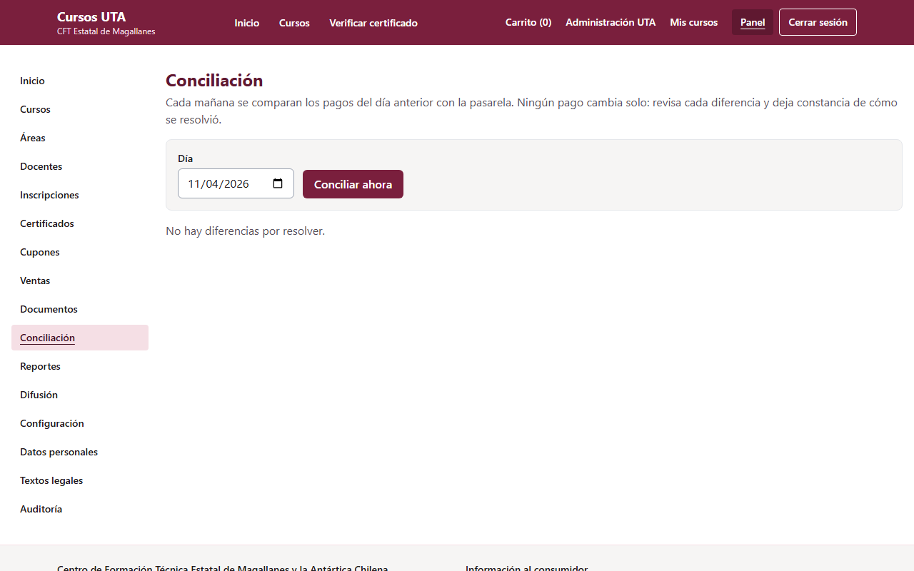

## Reportes

**Reportes** muestra ingresos, inscritos, aprobación, certificados y conversión por campaña. Elige el
período y si agrupas por curso, edición o mes. Cada tabla se descarga en Excel o CSV.

Una venta cuenta en el período en que se pagó, con sus devoluciones a la fecha. Por eso un mes ya
cerrado puede cambiar si después hay una devolución.

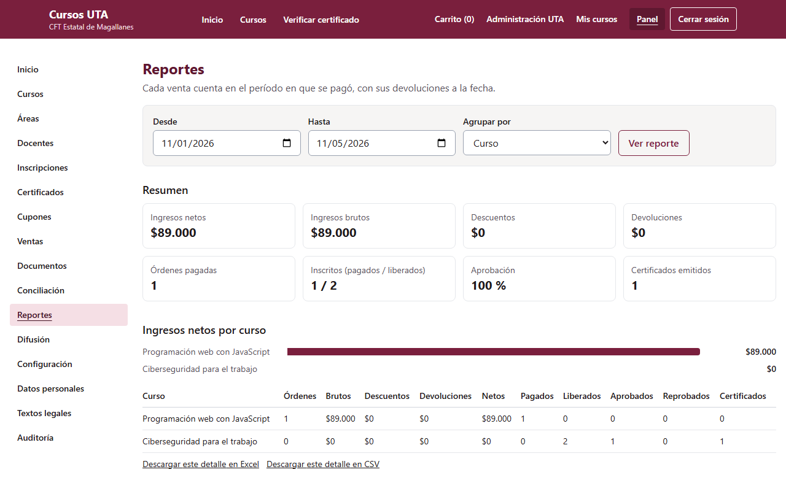

## Difusión

- **Generador de enlaces:** escribe la página, fuente, medio y campaña, y copia el enlace para tus
  publicaciones. Así los reportes muestran de dónde llegaron las ventas.
- **Novedades:** crea un borrador, revísalo y pulsa **Enviar**. Solo lo reciben quienes aceptaron, y
  cada mensaje lleva su enlace de baja.
- **Interesados:** lista de personas con su consentimiento.

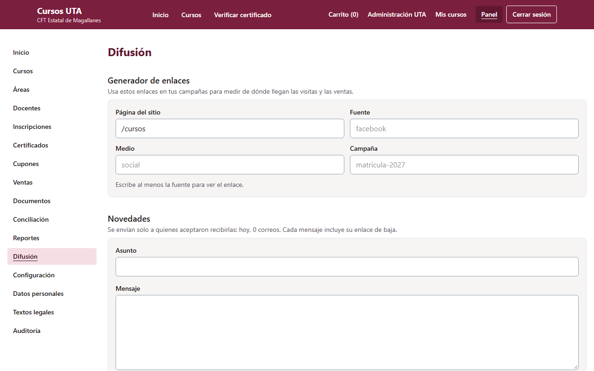

## Configuración

En **Configuración** se cambian los textos de la portada, un aviso general y el color principal. El
color debe ser oscuro: el sistema rechaza los que no permiten leer el texto blanco.

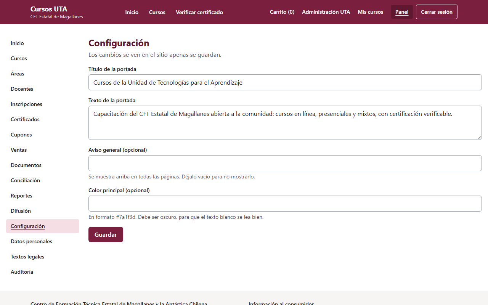

## Textos legales

Un texto publicado no se modifica: cada cambio es una **versión nueva** con su fecha de vigencia. La
compra exige aceptar la versión vigente y queda registrada cuál aceptó cada persona.

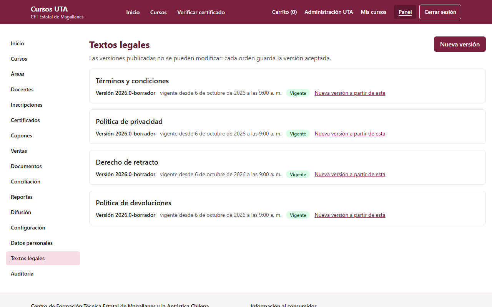

## Datos personales

Atiende aquí las solicitudes de acceso y supresión. **Verifica antes la identidad de quien lo pide.**

1. Busca por correo.
2. **Descargar sus datos** entrega un archivo con todo lo guardado.
3. **Anonimizar** borra nombre, correo y RUT, y **no se puede deshacer**. Las ventas se conservan sin
   esos datos, y los certificados emitidos mantienen el nombre impreso.

No se puede anonimizar a alguien con una orden o un curso en curso. El detalle está en
[datos-personales.md](datos-personales.md).

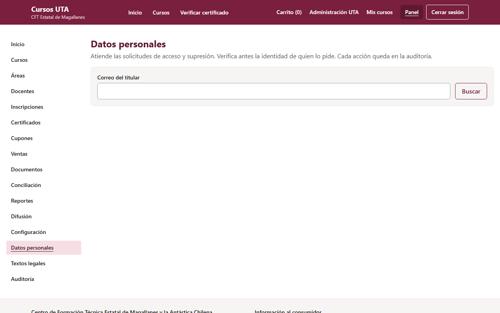

## Auditoría

**Auditoría** registra quién hizo qué y cuándo. No se puede modificar ni borrar. Puedes filtrar por
fecha, acción y persona.

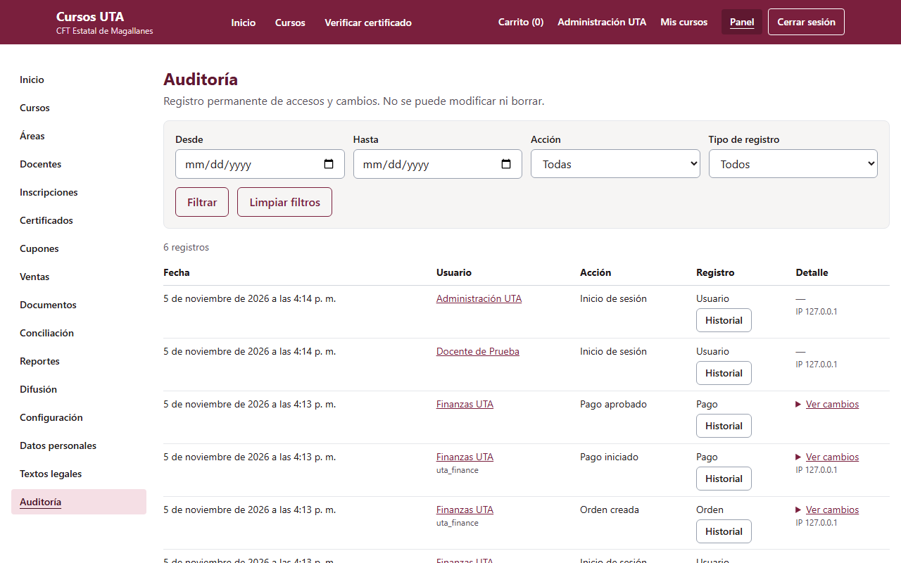

## Si algo falla

| Situación                                 | Qué hacer                                                                |
| ----------------------------------------- | ------------------------------------------------------------------------ |
| Pagó y no aparece matriculado             | Revisa **Inscripciones** y usa **Reintentar**                            |
| Falta un certificado                      | Pulsa **Sincronizar aprobación** en la edición                           |
| Llegó un correo de alerta de conciliación | Revisa **Conciliación**                                                  |
| Un documento quedó con error              | Lee el error en **Documentos**, corrige y usa **Reintentar**             |
| Hay que restaurar datos                   | Pide apoyo técnico: [respaldo-restauracion.md](respaldo-restauracion.md) |
