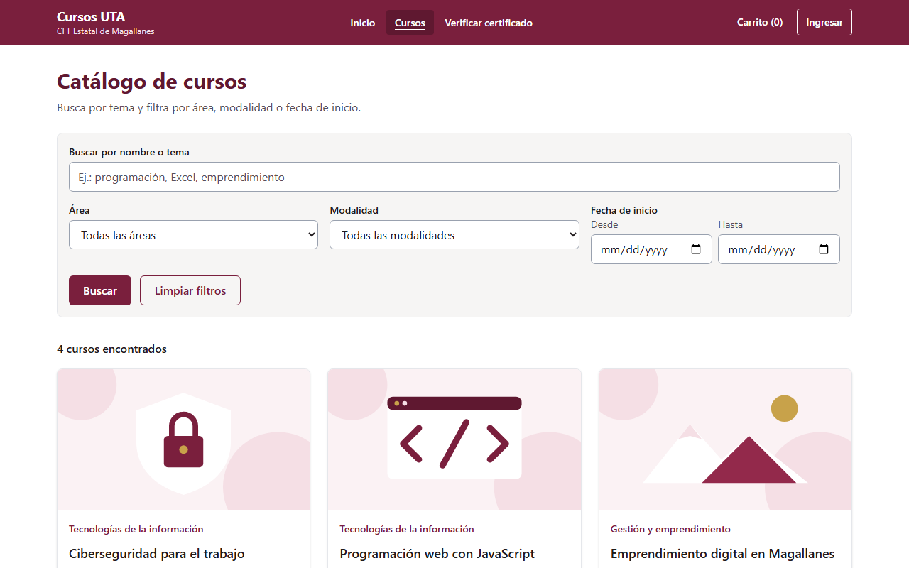
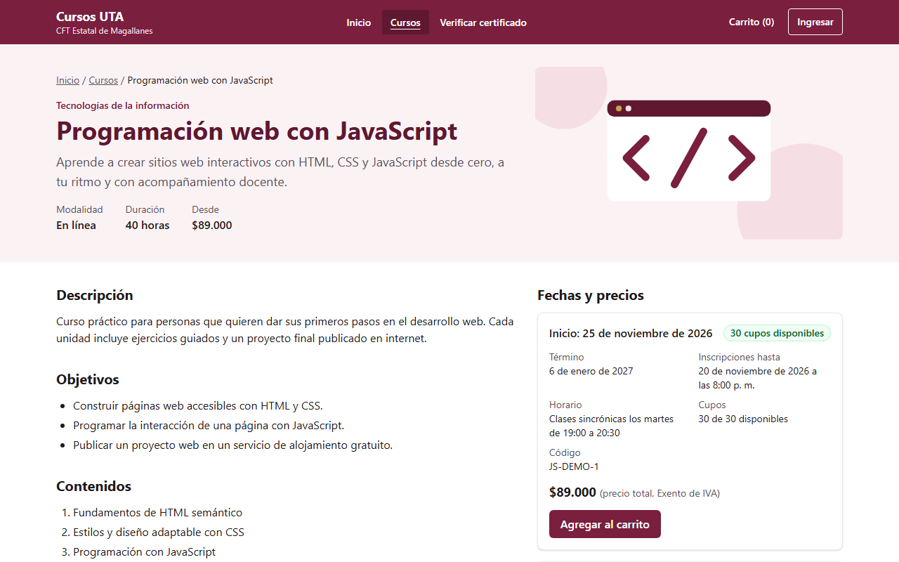
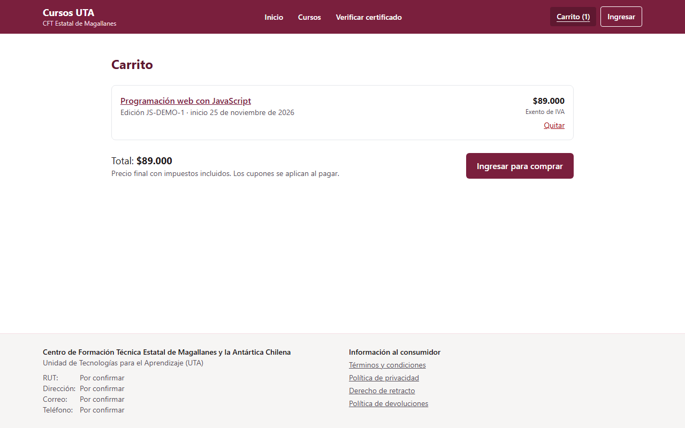
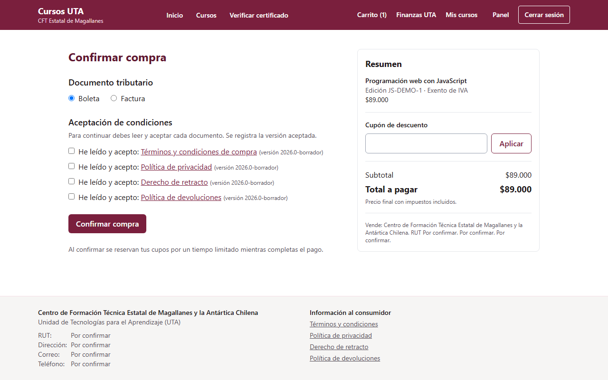
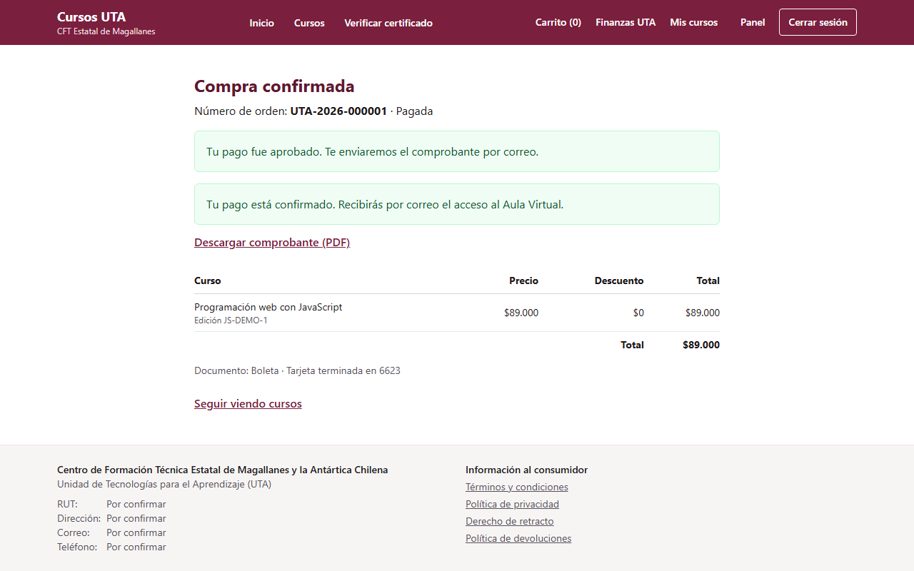
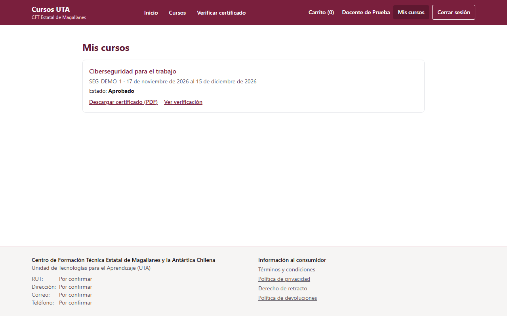
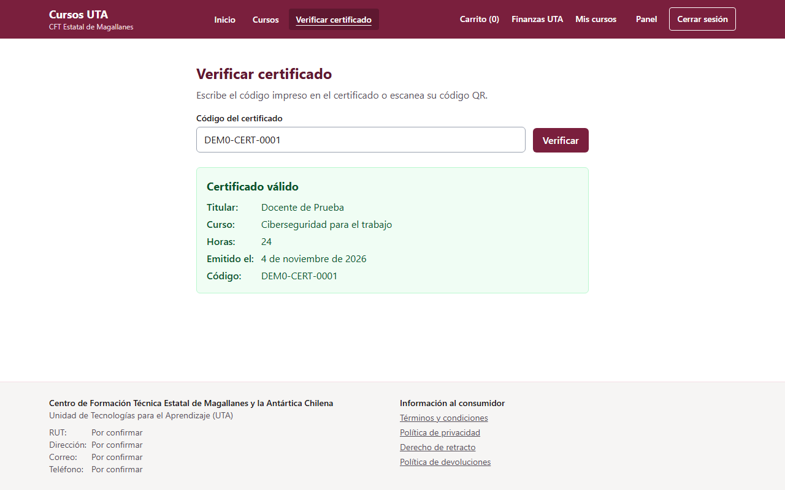

# Manual para compradores y estudiantes

Esta guía explica cómo encontrar un curso, comprarlo o inscribirse, entrar al Aula Virtual y obtener
tu certificado.

## 1. Encuentra tu curso

En **Cursos** puedes buscar por palabra y filtrar por área, modalidad y fecha.

Cada ficha muestra los objetivos, los contenidos, el docente y las ediciones disponibles, con sus
fechas, cupos y precio total.

Si el curso te interesa pero aún no quieres inscribirte, deja tu correo en **¿Te interesa este
curso?** y marca la casilla para recibir novedades. Puedes darte de baja cuando quieras con el enlace
que trae cada correo.

## 2. Inscríbete

Según la edición, verás una de estas opciones:

- **Agregar al carrito:** para pagar el curso.
- **Inscribirme sin costo:** si eres estudiante, docente o funcionario del CFT y la edición es
  liberada para la comunidad. Debes ingresar con tu cuenta institucional.
- **Unirme a la lista de espera:** si no quedan cupos. Si se libera uno, te avisaremos por correo y
  tendrás un plazo para comprar.

## 3. Compra

Revisa tu **Carrito** y sigue a la compra. Para continuar debes **Ingresar** con tu cuenta.

En la confirmación:

1. Si tienes un cupón, escríbelo y aplícalo.
2. Elige **boleta** o **factura**. Para factura se piden RUT, razón social, giro y dirección.
3. Lee y acepta los cuatro textos legales: términos, privacidad, retracto y devoluciones.
4. Pulsa **Confirmar compra**. Tu cupo queda reservado por unos minutos mientras pagas.

Al pagar, irás al sitio de la pasarela. Los datos de tu tarjeta se ingresan allí: nunca pasan por esta
plataforma.

Si el pago se aprueba, verás la confirmación y podrás descargar tu comprobante. También te llegará por
correo.

Si el pago se rechaza o lo cancelas, puedes volver a intentarlo desde la misma orden mientras tu
reserva siga vigente.

## 4. Entra al curso

Después del pago recibirás un correo con el acceso al Aula Virtual. Normalmente llega en pocos
minutos.

En **Mis cursos** ves el estado de cada curso y el enlace al Aula Virtual.

## 5. Obtén tu certificado

Cuando apruebes, el certificado llega por correo en PDF y queda disponible en **Mis cursos**. Lleva un
código y un código QR.

Cualquier persona puede comprobarlo en **Verificar certificado**, escribiendo el código. Solo se
muestran tu nombre, el curso, las horas y la fecha.

Si tu nombre tiene un error, escribe a la UTA para que reemita el certificado.

## Preguntas frecuentes

**No me llegó el correo.** Revisa la carpeta de correo no deseado. Si después de un rato no aparece,
escribe a la UTA con tu número de orden.

**Pagué, pero no veo el curso.** La matrícula en el Aula Virtual puede tardar unos minutos. Si pasa más
tiempo, contacta a la UTA con tu número de orden.

**Quiero arrepentirme.** El derecho de retracto y las devoluciones se explican en los enlaces del pie
de página. Escribe a la UTA con tu número de orden.

**Quiero saber qué datos tienen de mí, o que los borren.** Escribe a la UTA. La política de privacidad
está en el pie de página.
